<div align="center">

# KiCad Android

**The real KiCad 10.99 EDA suite, running natively on Android tablets and foldables.**

Schematics, PCB layout with the interactive router, 3D viewer and Gerber output, built from
upstream KiCad sources.

[](https://github.com/deveshrai/kicad-android/releases)
[](LICENSE)

-314CB0)

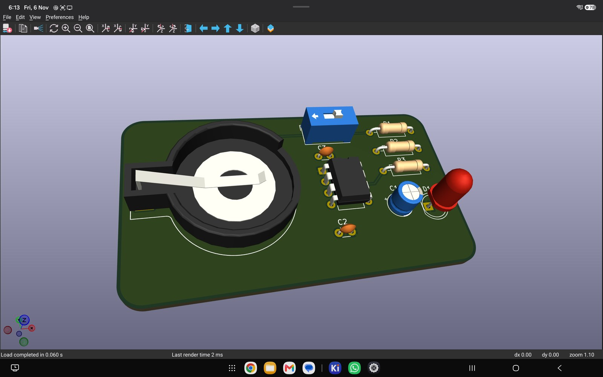

<sub>A 555 LED blinker, designed on a Galaxy Tab S12+ from schematic to 3D. STEP models rendered through OpenGL 2.1 on GLES.</sub>

</div>

> **Not an official KiCad release.**  This project is not affiliated with or endorsed by the KiCad
> project.  "KiCad" is a trademark of the KiCad project and is used here only to say what this
> software is built from.  Please report problems here, not on KiCad's issue tracker.

## Highlights

- **Full desktop KiCad, not a viewer.**  It includes the project manager, schematic editor, PCB
  editor and push-and-shove router, footprint and symbol editors, Gerber viewer, calculator and
  `kicad-cli`.
- **GPU canvas.**  It runs on KiCad's Vulkan backend, with pointer motion coalesced so the
  interactive router keeps up.
- **Built-in autorouter.**  **Route > Autoroute Board** runs
  [Freerouting](https://github.com/freerouting/freerouting)'s routing engine inside the app.
  You watch the routes appear on the board, then keep them or undo them in one step.
- **Built-in MCP server.**  Turn it on in **Preferences > MCP Server** and Claude Code (on the
  tablet in Termux, or on a computer on the same Wi-Fi) can read and edit your design, route it
  and run DRC while you watch.  It has designed [a whole board](#a-whole-board-over-mcp-esp32-s3-in-uno-format)
  this way, from an empty schematic to Gerbers.
- **3D viewer** with STEP component models, through [gl4es](https://github.com/ptitSeb/gl4es).
- **Desktop-identical output.**  Gerbers and drill files match the macOS build of the same sources
  byte for byte.  [How we checked](docs/CHANGES.md#how-it-was-checked).
- **Keyboard and mouse first**, with KiCad's normal hotkeys, plus touch gestures on the canvas.
- **Libraries included.**  The KiCad 10.0.8 symbol and footprint libraries are bundled.
- **Parts from SnapEDA and other parts sites in one step.**  **File > Import Library Package** adds a downloaded part's symbol, footprint and 3D model to your libraries.  **Export Library Package** packs a library back up to share.  [More below](#parts-from-snapeda-ultra-librarian-and-other-sites).

## From schematic to 3D on a tablet

A complete small board, a CR2032-powered 555 LED blinker, made in the app on a Samsung Galaxy Tab.
The project is in [`work/blinker`](work/blinker).

**1. Schematic.**  Place symbols from the bundled libraries, set values, wire, add power, and run
ERC until it shows 0 errors and 0 warnings.

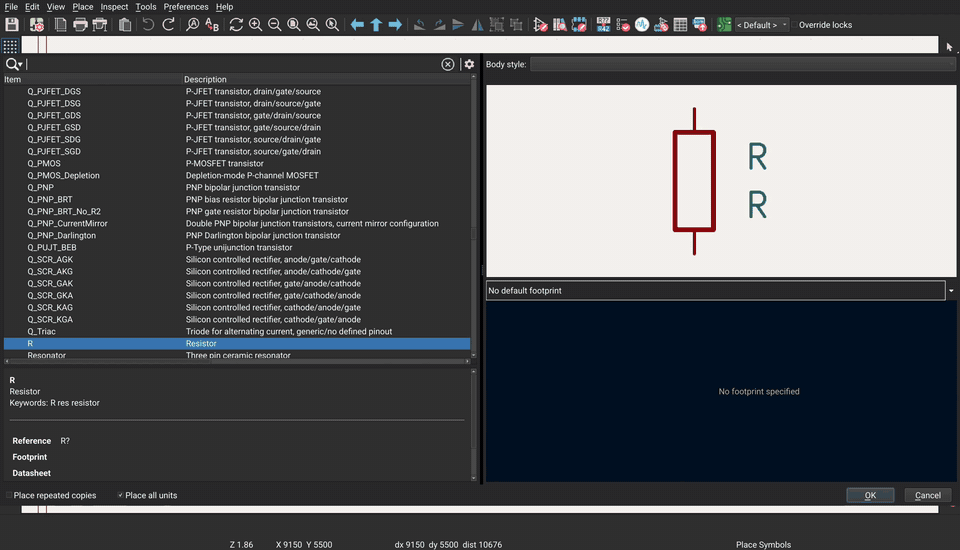

**2. PCB.**  Pull the footprints in from the schematic and drag them onto the board.  Route them
(the recording imports a Specctra session from Freerouting; since 10.99ae, **Route > Autoroute
Board** does the same on the device in under a second) and fill the ground zones.

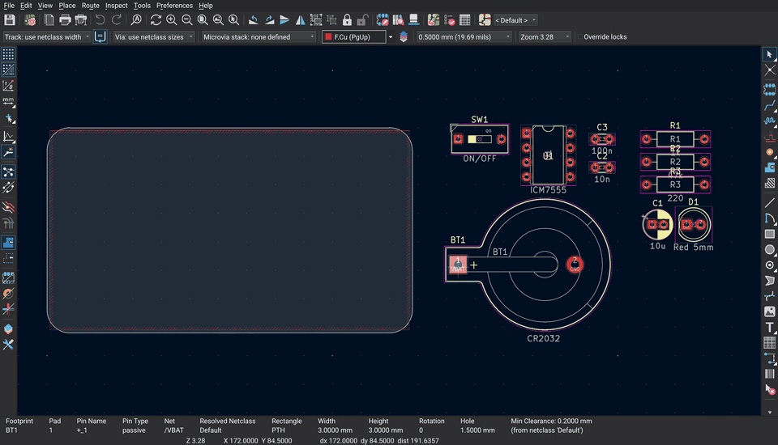

**Or let the built-in autorouter do it.**  Route > Autoroute Board routes the blinker in under a
second on the tablet, then the zones are refilled.

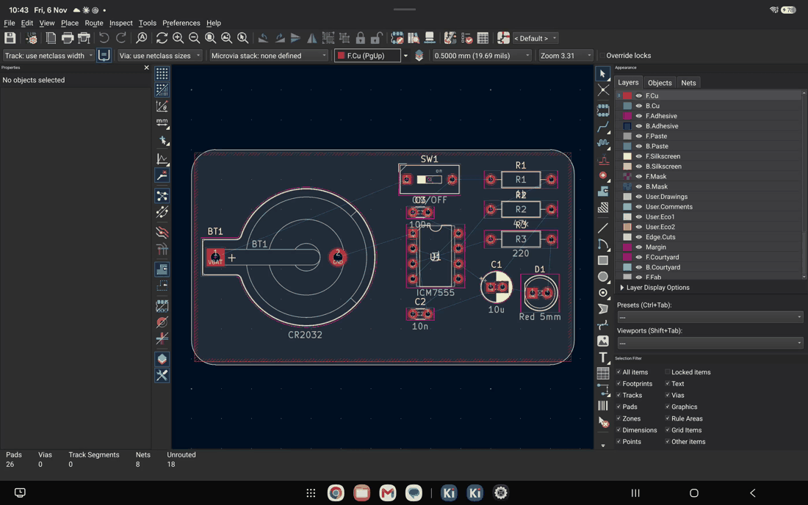 Autoroute Board routing the blinker on the tablet: the routes appear, Keep, and the ground zones fill" width="860">

**3. 3D.**  Check the board with its STEP component models.

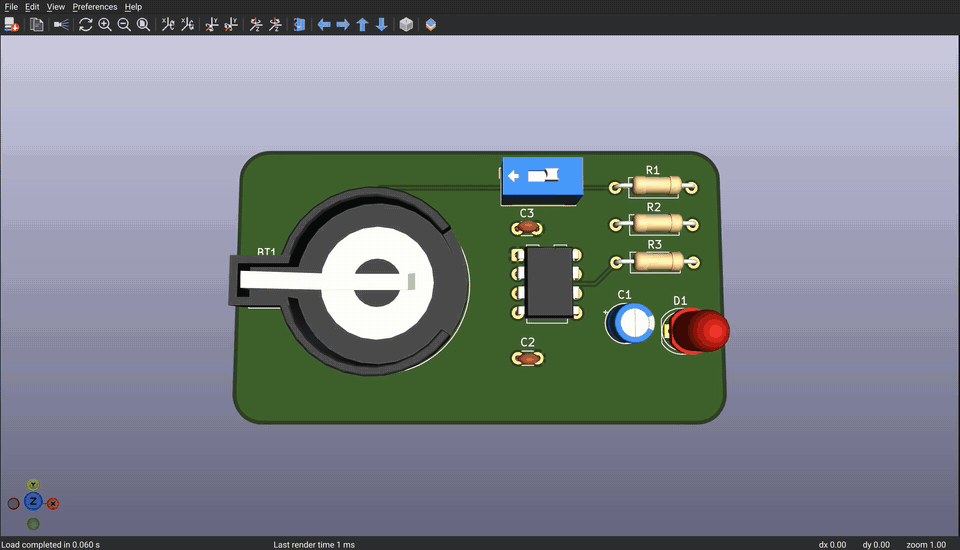

Full-resolution videos: [schematic](docs/media/video/schematic.mp4),
[PCB](docs/media/video/pcb-layout.mp4), [3D](docs/media/video/3d-blinker.mp4).

## Drive it from Claude Code

**Preferences > MCP Server** has a single switch.  Turn it on, copy the ready-made command, and
paste it into a terminal:

```
claude --mcp-config '{"mcpServers":{"kicad":{"type":"http","url":"http://127.0.0.1:27880/mcp","headers":{"Authorization":"Bearer <token>"}}}}'
```

Choose **This device** to connect from the tablet itself (for example Claude Code in Termux), or
**Another computer** to use the tablet's Wi-Fi address.  The status line shows when a client is
connected and what it last did.

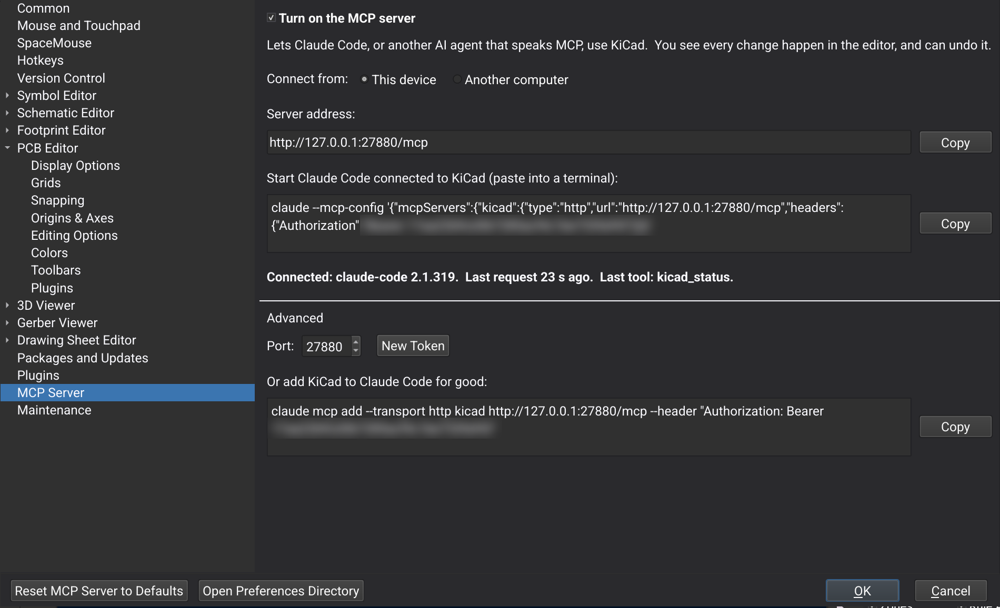 MCP Server: the on switch, This device or Another computer, the address and the claude --mcp-config command with Copy buttons, and the status line" width="860">

What a client can do:
- **See the design:** `kicad_status`, `kicad_open_editor`, `pcb_board_summary` (every footprint, its position, and the
  unrouted count).
- **Change it:** `pcb_move_footprint`, `pcb_autoroute`, `pcb_run_drc`.  The changes appear on the
  board as they happen, and each one is an undo step.
- **Do anything else KiCad's IPC API can:** `kicad_api` runs any API command (the API
  kicad-python uses), with `kicad_api_commands` and `kicad_api_describe` to find your way around.
  That covers creating tracks and zones, placing footprints and symbols from the libraries, net
  classes, design rules, and Gerber, drill and PDF exports.

### A whole board over MCP: ESP32-S3 in Uno format

Claude Code designed [this board](work/esp32s3-uno) on the tablet through the MCP server alone.
No tap or keystroke was made on the tablet; adb was used only to record the screen.

- **Schematic:**
  - an ESP32-S3-WROOM-1 with every IO on Uno-style shield headers plus a 2x8 header
  - USB-B like an Uno, and a 7-12 V jack with 5 V and 3.3 V regulators
  - RESET and BOOT buttons, and ON and L LEDs
- **Net classes for each kind of line:**

  | Class | Track | Clearance |
  |---|---|---|
  | Input power (VBUS, VIN) | 0.8 mm | 0.3 mm |
  | 5 V and 3.3 V rails | 0.6 mm | 0.25 mm |
  | GND (plus pours on both layers) | 0.5 mm | 0.2 mm |
  | USB differential pair | 0.3 mm | 0.2 mm |
  | Analog | 0.25 mm | 0.3 mm |
  | Digital, I2C, UART, GPIO | 0.25 mm | 0.2 mm |

- **Board:**
  - Placement, design rules, the built-in autorouter (107 of 107 connections) and GND pours.
  - DRC with no errors.
  - Gerbers, drill files and 3D renders, all exported over MCP.

The scripts, the finished project with its fab files, and the full log of the 465 MCP calls are
in [`work/esp32s3-uno`](work/esp32s3-uno).

<table>
<tr>
<td width="50%">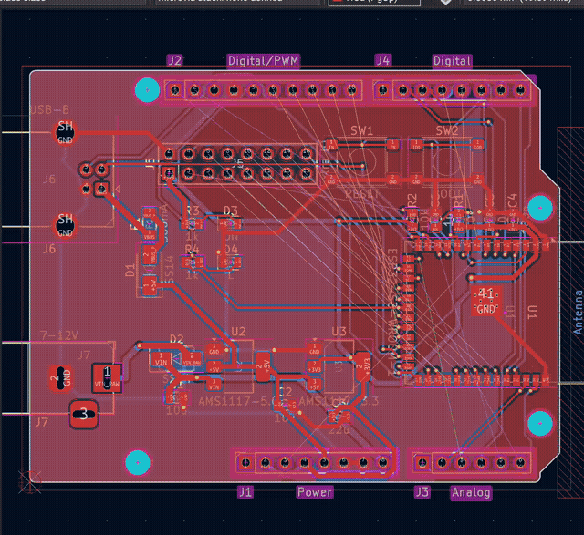</td>
<td width="50%">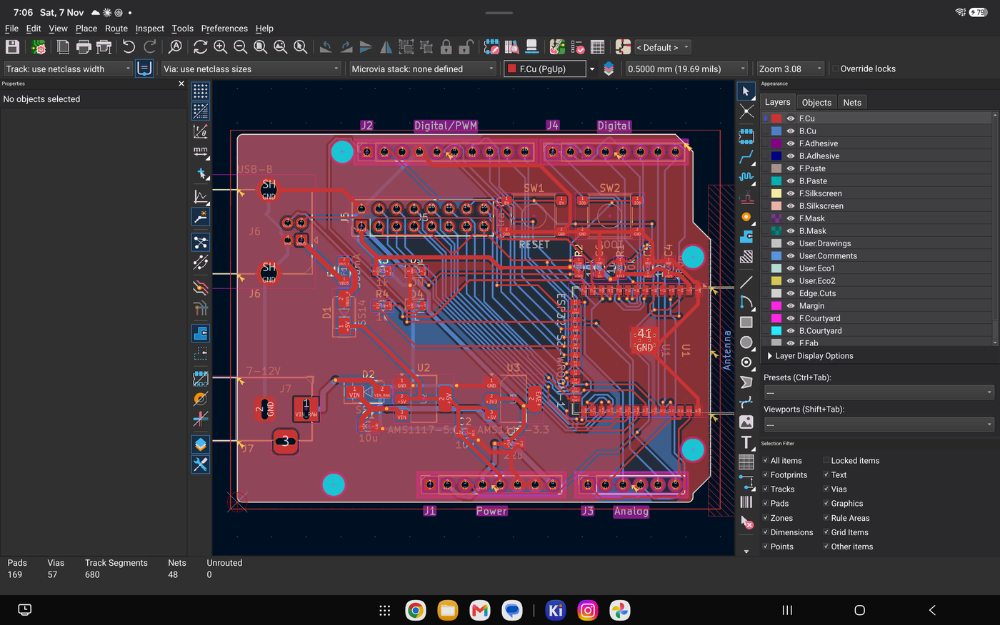</td>
</tr>
<tr>
<td>Autorouting over MCP, then the GND pours (10x speed; <a href="https://github.com/deveshrai/kicad-android/releases/download/android-10.99ag/esp32s3-uno-route.mp4">MP4</a>)</td>
<td>The finished board in the board editor</td>
</tr>
<tr>
<td>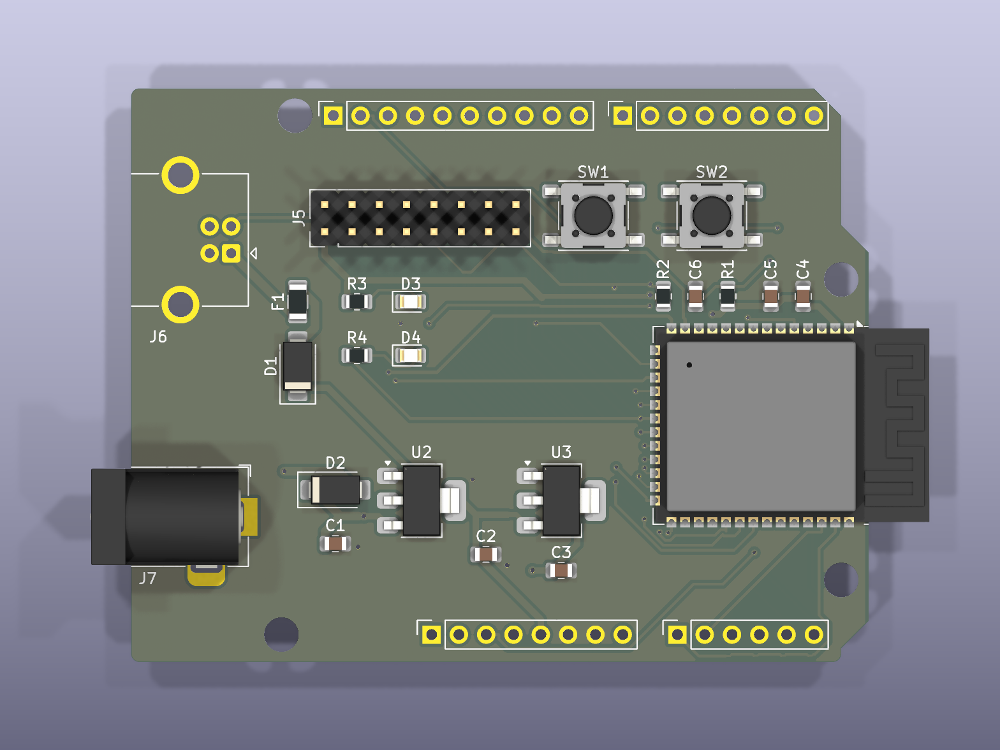</td>
<td>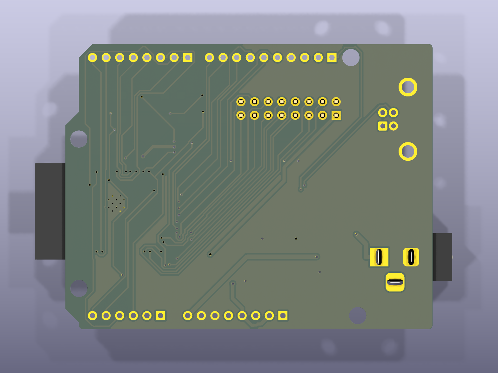</td>
</tr>
<tr>
<td>3D render, top (exported over MCP)</td>
<td>3D render, bottom</td>
</tr>
</table>

## See it run

<table>
<tr>
<td width="50%" align="center">
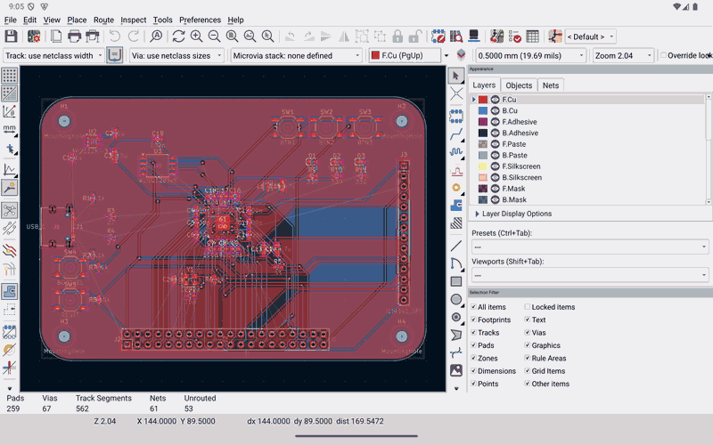<br>
<sub><b>Touch:</b> pinch to zoom, two fingers to pan, three-finger tap to fit</sub>
</td>
<td width="50%" align="center">
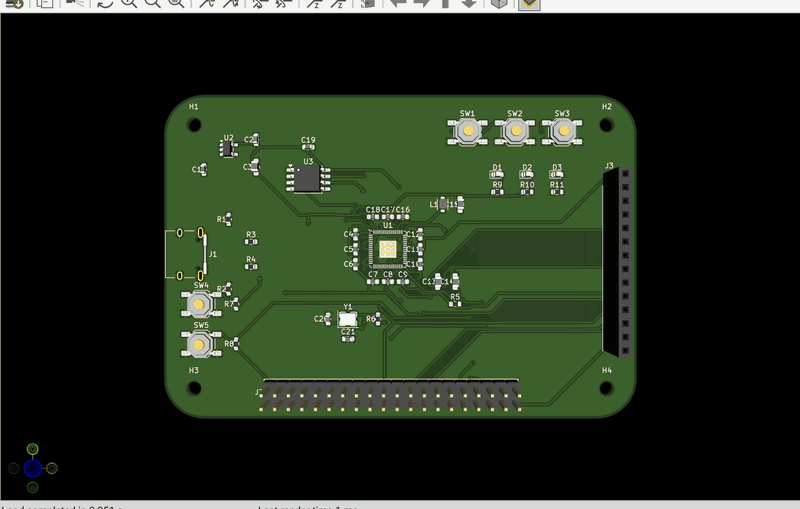<br>
<sub><b>3D viewer:</b> drag to orbit the board and its STEP models</sub>
</td>
</tr>
<tr>
<td width="50%" align="center">
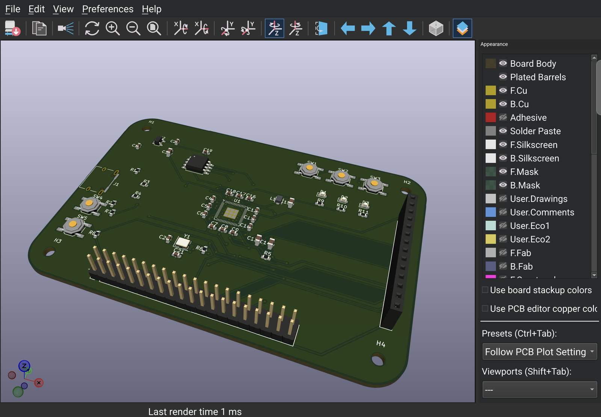<br>
<sub><b>3D viewer</b> on a Galaxy Z Fold, with an RP2350 board</sub>
</td>
<td width="50%" align="center">
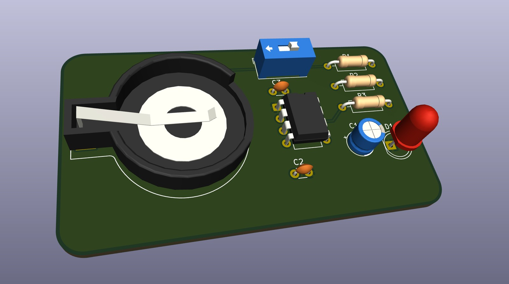<br>
<sub>The blinker's STEP models up close</sub>
</td>
</tr>
<tr>
<td width="50%" align="center">
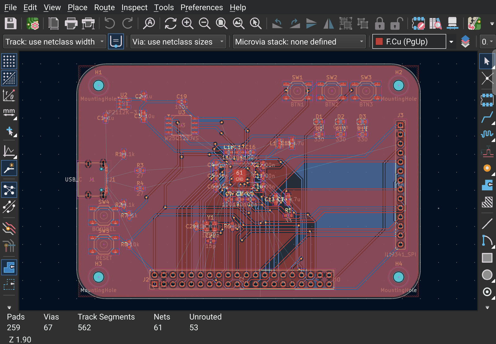<br>
<sub><b>PCB editor</b> on the Fold's inner screen</sub>
</td>
<td width="50%" align="center">
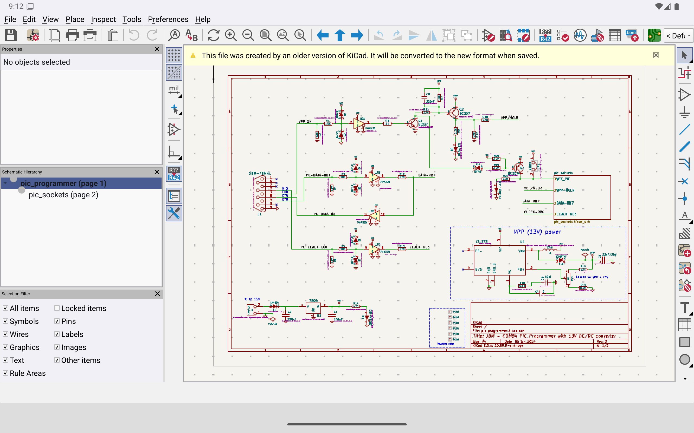<br>
<sub><b>Schematic editor</b> with a KiCad demo project</sub>
</td>
</tr>
</table>

## Install

1. Download the APK from [**Releases**](https://github.com/deveshrai/kicad-android/releases).
   It needs an arm64 device with Android 10 or newer.
2. Let your browser or file manager install apps, then open the APK.
3. On first start, grant **All files access**, so KiCad can open projects in shared storage
   (`Documents`).

A keyboard and mouse are recommended: a Bluetooth or USB keyboard, or Samsung DeX.

<details>
<summary><b>3D models</b> (not bundled, the full set is several GB)</summary>

Parts imported with **Import Library Package** bring their own 3D models.

For KiCad's own footprints:
1. Download the `.3dshapes` folders you need from [kicad-packages3D](https://gitlab.com/kicad/libraries/kicad-packages3D) into the project, for example `<project>/3dmodels`.
2. Set a project text variable named `KICAD10_3DMODEL_DIR` to `${KIPRJMOD}/3dmodels`. Use the schematic editor's **File > Schematic Setup > Project > Text Variables**, or the MCP server's `SetTextVariables`.

Preferences > Configure Paths can't be edited on Android yet.

</details>

## Parts from SnapEDA, Ultra Librarian and other sites

Download the part's **KiCad** zip in the browser, then in the project manager choose
**File > Import Library Package...** and pick the zip from Downloads.  Choose **All Projects**
or **This Project** (the files are then copied into the project folder, so they travel with it).
The symbol, footprint and 3D model are ready to place straight away:

- The footprint's 3D model path, which usually points into the author's own computer, is
  pointed at the unpacked model.
- The symbol's footprint field is pointed at the footprint library.
- The libraries are added to the library tables and loaded in the open editors.
- Importing the same zip again updates the part.

**File > Export Library Package...** does the reverse.  It saves a symbol library, the footprints
its symbols use and their 3D models as one zip, ready to import on another device or into
desktop KiCad.

<table>
<tr>
<td width="50%">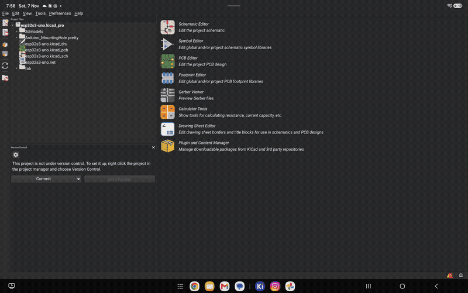 Import Library Package on the tablet: the Android file picker finds the SnapEDA zip, All Projects, and the summary of what was added"></td>
<td width="50%">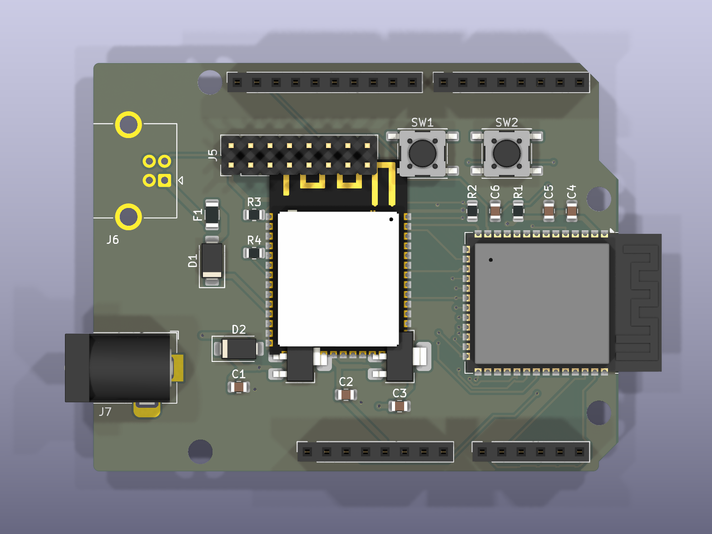</td>
</tr>
<tr>
<td>Importing SnapEDA's ESP32-S31-WROOM-1 zip on the tablet</td>
<td>The imported footprint with its 3D model, trial-placed on a board</td>
</tr>
</table>

Both are also MCP tools (`kicad_import_library_package`, `kicad_export_library_package`), so
Claude Code can bring in the parts a design needs.

## Using it

| Input | What it does |
|---|---|
| Mouse and keyboard | Same as KiCad on the desktop, hotkeys included |
| One finger on the canvas | Left mouse button: click, select, drag, draw tracks and wires |
| Two fingers | Pinch to zoom around your fingers; drag to pan |
| Three-finger tap | Zoom to fit |

## How it works

KiCad's UI is written against wxWidgets, which has no Android port.  This build runs wxWidgets'
**Qt port** on **Qt 6 for Android**.  KiCad draws its canvas with **Vulkan** and its 3D view with
**OpenGL 2.1 via gl4es**.  It stays close to upstream: everything is a patch series against exact
upstream revisions.

| Layer | Changes |
|---|---|
| KiCad | [`patches/kicad`](patches/kicad): Android platform layer, Vulkan canvas, touch, 3D viewer, a few general fixes |
| wxWidgets (wxQt) | [`patches/wxwidgets`](patches/wxwidgets): input, dialogs, fonts, Android pickers and intents, crash fixes |
| Qt for Android | [`patches/qtbase`](patches/qtbase): faster window composition, input-method fixes |
| MCP server | part of [`patches/kicad`](patches/kicad) (patch 0031): an MCP server on KiCad's IPC API, with a one-page settings panel |
| Freerouting | [`patches/freerouting`](patches/freerouting): its routing core built for Android's Java runtime, driven by [`android/autorouter`](android/autorouter) |

**[Read the full write-up of the changes →](docs/CHANGES.md)**

## Status

This is a development build of KiCad master.  It works for real design work with a keyboard and
mouse.  Known rough edges:

- Some dialogs open partly under the status bar, or with their buttons clipped, at tablet scales.
- Docked panels can cover the canvas on smaller screens.  Close them from **View > Panels**.
- The soft keyboard can cover the field being edited.
- The 3D viewer doesn't take touch gestures yet; it gets the standard mouse emulation.

The working notes and the full list are in [`docs/HANDOVER.md`](docs/HANDOVER.md).

## Building from source

The build runs on macOS (Apple silicon).  It needs:

- Android NDK r29, SDK build tools 35/36 and a JDK 17
- Qt 6.12.0 for Android arm64 and for macOS
- vcpkg

Then run:

```sh
scripts/build-deps.sh          # vcpkg dependencies for arm64-android
scripts/build-wxqt-android.sh  # wxWidgets (wxQt) + patches/wxwidgets
scripts/build-qtforandroid.sh  # Qt's Android platform plugin + patches/qtbase
scripts/build-gl4es.sh         # libGL.so for the 3D viewer
scripts/build-kicad-android.sh # KiCad + patches/kicad
scripts/build-kicad-apk.sh     # the APK
```

- [`SOURCES.md`](SOURCES.md) lists the exact upstream revision each patch series applies to.
- [`PLAN.md`](PLAN.md) covers the architecture.
- [`docs/HANDOVER.md`](docs/HANDOVER.md) covers the toolchain, devices and test setup.

Most of this port was written with an AI coding assistant (Claude); see the commit trailers.

## Licence

- This repository's own files are licensed **GPL-3.0-or-later** ([`LICENSE`](LICENSE)).
- Each patch carries the licence of the project it modifies:
  - KiCad: GPL-3.0-or-later
  - wxWidgets: wxWindows Library Licence
  - Qt: LGPL-3.0
- The APK combines KiCad with Qt (LGPL-3.0), wxWidgets, gl4es (MIT) and the libraries in
  [`SOURCES.md`](SOURCES.md), each under its own licence.  The bundled KiCad libraries are
  CC-BY-SA-4.0 with the KiCad library exception.
- The corresponding source for every published APK is this repository at the release tag, together
  with the upstream revisions in `SOURCES.md`.
