# Autoroute manual

KiCad Android's **Route > Autoroute** routes boards on the device with one of two built-in
routers.  This manual covers every part of the tool, with screenshots from a Samsung Galaxy Tab
(the board is [`work/rp2350`](../work/rp2350), an RP2350 board with a 0.4 mm-pitch QFN-60, a
40-pin header and a display connector).

- [The two routers](#the-two-routers)
- [Opening the tool: dialog or docked](#opening-the-tool-dialog-or-docked)
- [Route](#route)
- [Fan Out](#fan-out)
- [Planes](#planes)
- [Optimize](#optimize)
- [Settings](#settings)
- [While it runs](#while-it-runs)
- [The result: keep, discard or run again](#the-result-keep-discard-or-run-again)
- [Recipes](#recipes)
- [From Claude Code (MCP)](#from-claude-code-mcp)
- [How it works](#how-it-works)
- [Limits and known issues](#limits-and-known-issues)

## The two routers

| | KiCadRoutingTools (default) | Freerouting |
|---|---|---|
| What it is | [Andy Haas's router](https://github.com/drandyhaas/KiCadRoutingTools): a grid A* router with rip-up and reroute, written in Python with a Rust core | [Freerouting](https://github.com/freerouting/freerouting) 2.5's routing core: a gridless push-and-shove router with an optimizer |
| Best at | Fine-pitch parts (it fans them out), routing chosen nets, buses, keeping to your rules | Quick whole-board passes; optimizing finished routing |
| Runs | In its own process, with Python 3.14, numpy, scipy and shapely bundled | In the app's Java runtime |
| Fan out single parts | Yes | No (only every SMD pad at once) |
| Bus routing | Yes | No |
| Grid | Yes (you choose it) | Gridless |
| Optimizer passes | No | Yes |

The choice is at the top of the tool.  Settings a router doesn't use are greyed out for it.

On the RP2350A board this tool was tested on (2 layers, a 0.4 mm QFN-60, 162 connections), with
KiCad's DRC and the board's own rules as the judge:

| | Connections left | DRC errors added |
|---|---|---|
| Freerouting | 86 | 11 |
| KiCadRoutingTools, U1 fanned out first | 31 | 0 |
| KiCadRoutingTools, 4 layers with GND and 3V3 planes | 20 of 168 | 0 |

## Opening the tool: dialog or docked

**Route > Autoroute...**

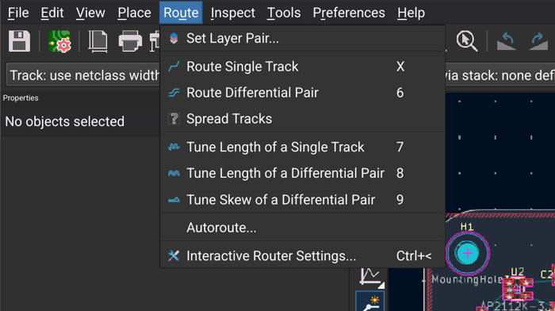

The tool opens either as a **dialog** over the board, or **docked** in the panel column at the
left of the editor, the full height of the window.  **Dock to Side** in the dialog docks it;
**Undock** in the docked panel turns it back into a dialog.  It remembers which you used last.

Docked, it takes the place of the Properties panel while it's shown (Properties comes back when you
close the tool), so the board keeps its width:

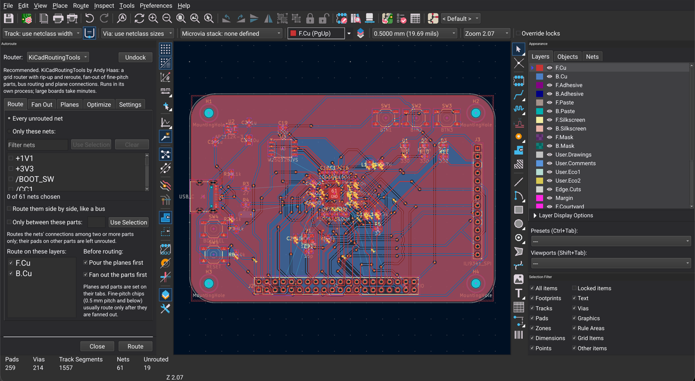

As a dialog:

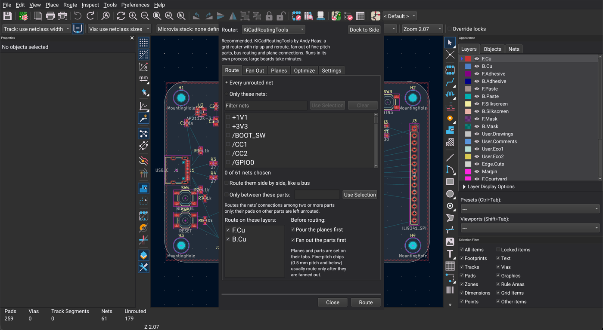

At the top:

- **Router:** KiCadRoutingTools or Freerouting, with a line about the one chosen.
- **Dock to Side / Undock.**
- The tabs: **Route**, **Fan Out**, **Planes**, **Optimize** and **Settings**.  The button at the
  bottom does what the tab is for: **Route**, **Fan Out**, **Pour Planes** or **Optimize**.

## Route

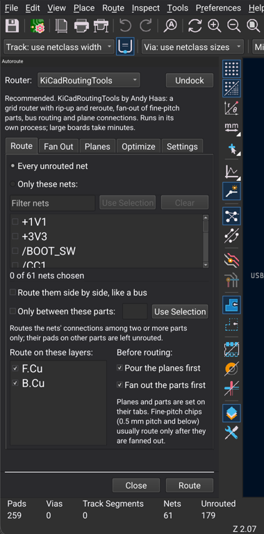
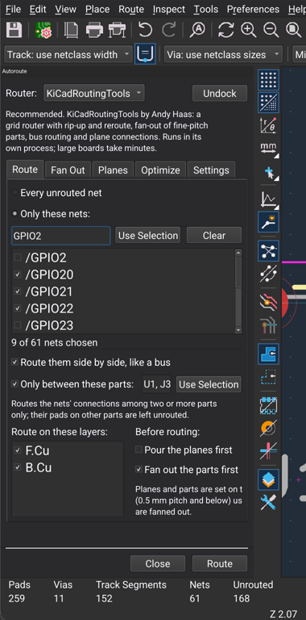

- **Every unrouted net**, or **Only these nets:** tick nets in the list.
  - Type in **Filter nets** to narrow the list (ticked nets stay ticked while hidden).
  - **Use Selection** ticks the nets of what is selected on the board: tracks, pads, or every
    net of a selected footprint.
  - **Clear** unticks them all.  The line under the list counts the nets chosen.
- **Route them side by side, like a bus** (KiCadRoutingTools): the chosen nets are routed
  together, kept close and parallel.  Use it for data buses, SPI to a display, and so on.
- **Only between these parts:** route the chosen nets only between two or more parts, for
  example the processor and the display connector.  Their pads on other parts are left
  unrouted for later.  Type the references (`U1, J3`), or select the parts on the board and tap
  **Use Selection**.
- **Route on these layers:** untick a layer to keep the router off it (an inner plane layer,
  say).
- **Before routing:**
  - **Pour the planes first:** pours the planes listed on the Planes tab, then routes.
  - **Fan out the parts first** (KiCadRoutingTools): fans out the parts ticked on the Fan Out
    tab, then routes.  Fine-pitch chips (0.5 mm pitch and below) usually route only after they
    are fanned out.

When you route chosen nets, the router leaves every other net's copper alone, unless you allow it
on the Settings tab.

## Fan Out

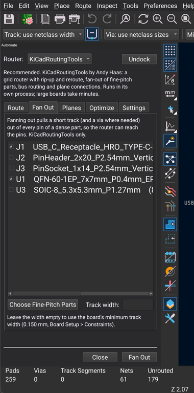

Fanning out pulls a short track, and a via where needed, out of every pin of a dense part, so the
router can reach its pins.  KiCadRoutingTools only.

- The list shows every part with 8 or more pads, with its pad count and pitch.
- **Choose Fine-Pitch Parts** ticks every part at 0.5 mm pitch or below.  The tool does this by
  itself the first time it opens.
- **Track width:** empty uses the board's minimum track width (Board Setup > Constraints).  A
  0.4 mm-pitch QFN with 0.2 mm clearances needs 0.15 mm tracks to get out.
- QFN, QFP and similar parts get escape stubs; BGA and WLCSP parts get dog-bone vias.
- **Fan Out** on this tab fans out only.  To fan out and route in one go, tick **Fan out the parts
  first** on the Route tab.

## Planes

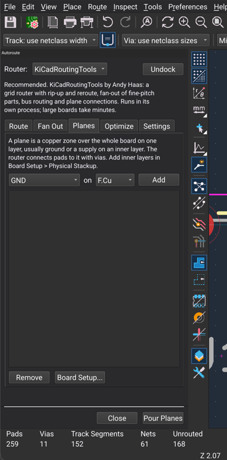

A plane is a copper zone over the whole board on one layer, usually ground or a supply on an inner
layer.  The router connects pads to it with vias.

- Choose the net and the layer, then **Add**.  **Remove** takes the selected plane off the list.
- **Pour Planes** on this tab only pours them.  **Pour the planes first** on the Route tab pours
  them and then routes.
- A plane that already exists (a zone of that net on that layer) is left as it is.
- For inner layers, make the board 4 layers or more first: **File > Board Setup > Physical
  Stackup**.  On the RP2350A board, GND on In1.Cu and 3V3 on In2.Cu cut the connections left
  from 31 to 20.

## Optimize

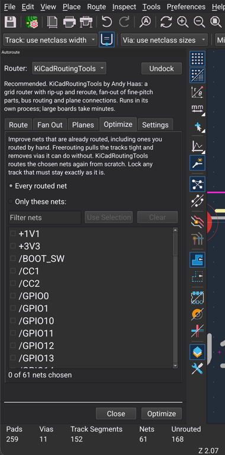

Improves nets that are already routed, including ones you routed by hand.

- **Every routed net**, or **Only these nets** (the same list as on the Route tab).
- **Freerouting** pulls tracks tight and removes vias it can do without.  It works on what is
  routed even when the board isn't finished.
- **KiCadRoutingTools** rips the chosen nets up and routes them again from scratch.
- Lock any track that must stay exactly as it is (select it, then **Lock**): the tool never
  removes a locked track.

## Settings

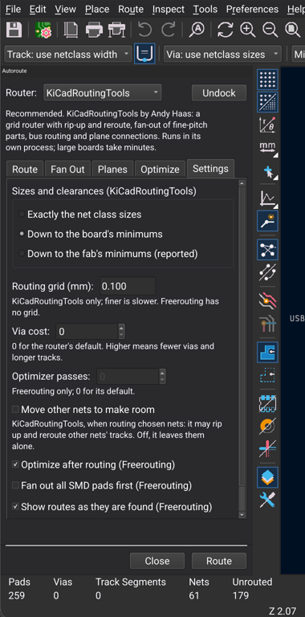

- **Sizes and clearances** (KiCadRoutingTools): what the router may do when a net doesn't fit
  at its net class's track width and clearance:
  - **Exactly the net class sizes:** never go smaller; the net fails instead.
  - **Down to the board's minimums** (the default): down to Board Setup > Constraints, never
    below what KiCad's DRC accepts for this board.
  - **Down to the fab's minimums:** down to a fab's standard and advanced limits.  Every place
    it does so is reported, and KiCad's DRC may then flag them against your rules.
- **Routing grid (mm)** (KiCadRoutingTools): 0.1 mm by default.  A finer grid can fit tighter
  spots but is slower.
- **Via cost:** 0 for the router's default.  Higher means fewer vias and longer tracks.
- **Optimizer passes** (Freerouting): 0 for its default.
- **Move other nets to make room** (KiCadRoutingTools, when routing chosen nets): lets the router
  rip up and reroute other nets' tracks.  Off, it leaves them as they are.
- **Optimize after routing**, **Fan out all SMD pads first** and **Show routes as they are found**
  (Freerouting).
- **Refill zones when the result is kept.**

## While it runs

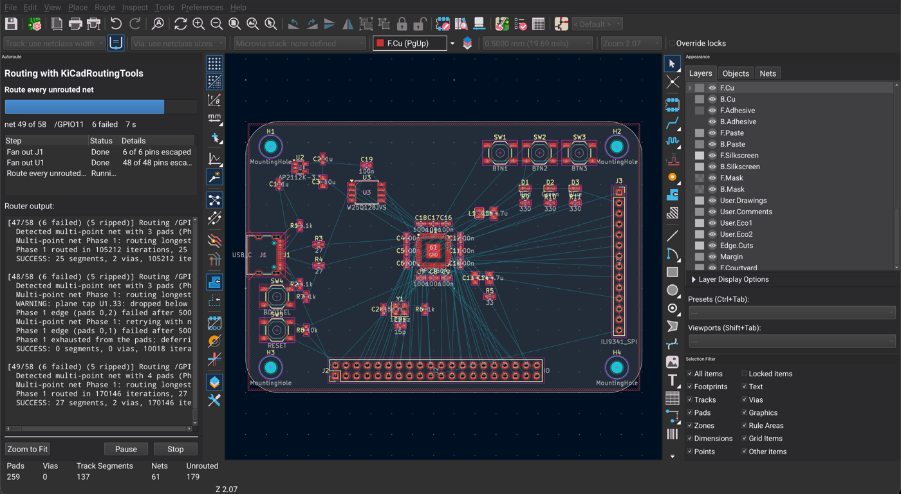

- The tool shows:
  - the router and what it's doing (fanning out U1, routing, rerouting the nets that did not fit);
  - a progress bar, the net being routed, nets failed so far, vias and the time;
  - each step with its state and result (for example "48 of 48 pins escaped");
  - the router's own output.
- **The board is locked** for the whole run, so nothing can be drawn underneath the router:
  - Docked, the menus, toolbars and other panels are greyed out, and taps and keys on the board
    are ignored.  The board still draws, so you see each step's routes arrive.
  - As a dialog, the dialog is modal.
  - KiCad's API and the MCP tools that edit the board answer "busy".
- **Pause** stops the router where it is (it uses no CPU while paused); **Resume** carries on.
- **Stop** ends the run.  What was done so far stays on the board, to keep or discard.
- Closing the tool during a run stops it.  The board editor can't be closed until the run is
  kept or discarded.

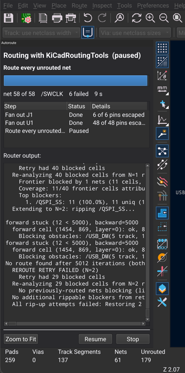

KiCadRoutingTools works step by step: pour planes, fan out each part, route.  The board takes each
step's result as soon as it is done.  Freerouting shows its routes pass by pass.

## The result: keep, discard or run again

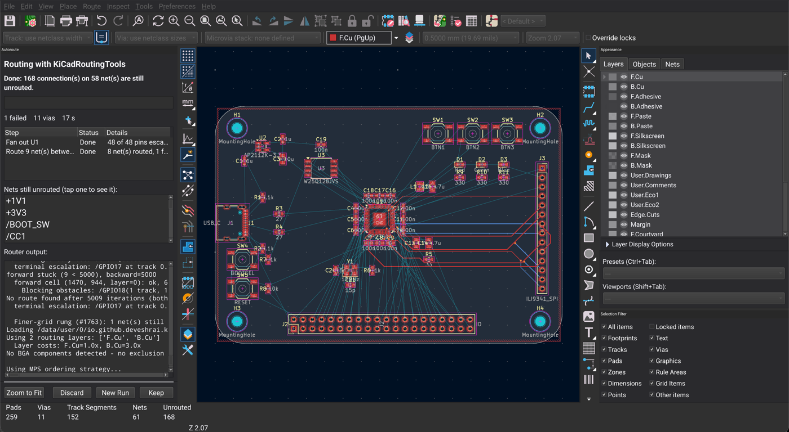

- The tool says what happened ("Done: every connection is routed", or how many are left), and
  lists the nets that still have unrouted connections.
- **Tap a net** in the list to zoom to it, highlighted:

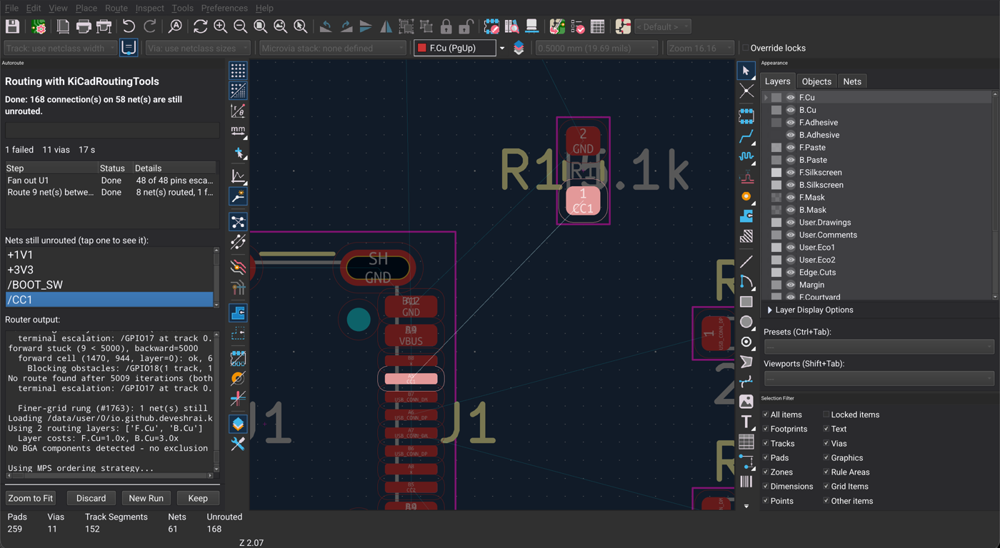

- **Keep** keeps the result and refills the zones (if that setting is on).  The dialog closes;
  the docked tool goes back to its tabs.
- **Discard** undoes the whole run and goes back to the tabs.
- **New Run** keeps the result and goes back to the tabs for another run on top of it: route the
  rest, optimize, and so on.
- **Zoom to Fit** shows the whole board.
- Each run is one undo step (**Edit > Undo**).

## Recipes

### A board with a fine-pitch processor

1. **Fan Out:** check that the processor is ticked (**Choose Fine-Pitch Parts**).  Leave the
   track width empty, or set what fits between its pads (0.15 mm for a 0.4 mm-pitch QFN with
   0.2 mm clearances).
2. **Route:** **Every unrouted net**, **Fan out the parts first** ticked.
3. **Route.**  On the RP2350 board in these screenshots it takes about 8 minutes on the tablet.
   - U1 (48 of 48 pins) and the USB-C connector J1 fan out completely.
   - 43 of the 58 nets route.
   - After the GND pours refill on Keep, 19 of the board's 179 connections are left.
   - KiCad's DRC finds no clearance or width errors. It does find 11 "starved thermal" pads:
     ground pads whose spokes into the pour are blocked by the new tracks. Reconnect those
     with a short track, or route GND to them.
4. Route the nets that are left by hand, or move parts and route them again with **Only these
   nets**.

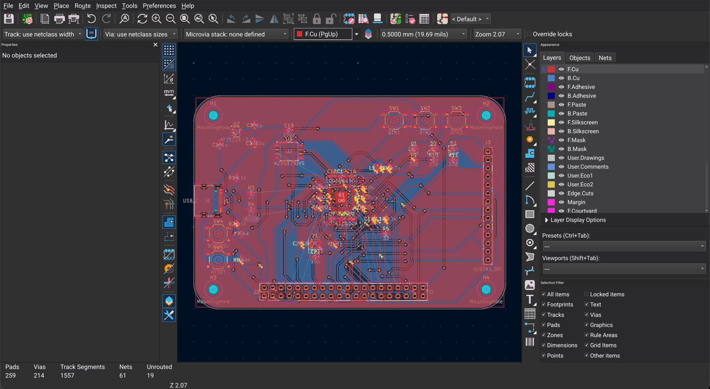

### A bus between two parts

The RP2350 board's display bus (GPIO14 to GPIO22) goes to the display connector J3 and to the
40-pin header J2.  To route it to the display first:

1. **Route:** **Only these nets**, filter `GPIO`, tick GPIO14 to GPIO22.
2. Tick **Route them side by side, like a bus**.
3. Tick **Only between these parts** and type `U1, J3`.
4. **Fan out the parts first**, with U1 ticked on the Fan Out tab.
5. **Route.**  17 seconds on the tablet: eight of the nine nets routed side by side.  Nothing else
   on the board was touched, and J2 was left for later.

### Ground and supply planes on 4 layers

1. **File > Board Setup > Physical Stackup:** 4 copper layers.
2. **Planes:** GND on In1.Cu, **Add**; 3V3 on In2.Cu, **Add**.
3. **Route:** untick In1.Cu and In2.Cu under **Route on these layers**, so the planes stay solid.
   Tick **Pour the planes first**.
4. **Route.**  Pads on the plane nets get vias to their plane.

### Tidy up routing you did by hand

1. Lock any track that must not move.
2. **Router: Freerouting**, **Optimize** tab, **Only these nets**, tick the nets.
3. **Optimize.**  Compare, then **Keep** or **Discard**.

## From Claude Code (MCP)

With **Preferences > MCP Server** on, Claude Code (or any MCP client) drives the same tool.  The
run shows on the tablet, in the dialog or docked, and locks the board the same way.

- `pcb_autoroute` starts a run and returns once it has started (`"wait": true` to return at the
  end, for small boards).  Its arguments are the tool's settings:

  ```json
  { "router": "kicadroutingtools",
    "task": "route",
    "nets": ["/GPIO14", "/GPIO15", "/GPIO16"],
    "bus": true,
    "between_parts": ["U1", "J3"],
    "fanout_parts": ["U1"],
    "rules": "board" }
  ```

  - `router`: `"kicadroutingtools"` or `"freerouting"`.
  - `task`: `"route"`, `"fanout"`, `"planes"` or `"optimize"`.
  - `nets` and `optimize_nets`: `"all"` or a list.
  - The rest: `layers`, `fanout_first`, `fanout_width_mm`, `planes` (`[{"net": "GND", "layer":
    "In1.Cu"}]`), `planes_first`, `rules` (`"exact"`, `"board"`, `"fab"`), `grid_mm`,
    `via_cost`, `optimizer_passes`, `optimize_after`, `rip_other_nets`, `refill_zones`.
- `pcb_autoroute_status` reports:
  - the state (`running`, `paused`, `finished`, `stopped`, `failed`) and each step;
  - the net being routed and the progress;
  - the router's last lines;
  - at the end, the nets still unrouted.
- `pcb_autoroute_control` with `"action"`: `"pause"`, `"resume"`, `"stop"`, then `"keep"` or
  `"discard"`, which ends the run and closes the tool.

While a run is active or waiting to be kept, `pcb_move_footprint`, `pcb_run_drc` and `kicad_api`
answer "busy".

## How it works

- **KiCadRoutingTools:**
  - It runs unchanged on python.org's Python 3.14 for Android, with numpy, scipy (built without
    Fortran, on OpenBLAS) and shapely (on GEOS), all built for Android by
    [`scripts/build-python-android.sh`](../scripts/build-python-android.sh).
  - The first run after installing unpacks it, about 150 MB, which takes about a minute.
  - Each step runs in a process of its own (`android/router`), a foreground service, so a crash
    or a memory spike in the router can't take KiCad down.  Pause and resume stop and continue
    that process; Stop ends it.
  - KiCad writes a copy of the board and project for the router and reads each step's result back
    into the board as part of the run's undo step.
  - Routing chosen nets runs the router with its rip-up of other nets switched off
    (`KICAD_RIP_PREEXISTING=0` and friends), unless **Move other nets to make room** is ticked.
  - "Only between these parts" hides the chosen nets' pads on other parts from the router.
- **Freerouting:** KiCad exports a Specctra DSN file, Freerouting routes it in the app's Java
  runtime, and its session file comes back in, pass by pass.  The app's Freerouting adds pause and
  an only-these-nets filter to Freerouting 2.5 ([`patches/freerouting`](../patches/freerouting)).
- The code: [`patches/kicad`](../patches/kicad) (patches 0038 and 0039:
  `pcbnew/autoroute/autoroute_job.cpp` runs the steps, `autoroute_panel.cpp` is the tool).

## Limits and known issues

- **Time:** KiCadRoutingTools is several times slower on the tablet than on a desktop: a full route
  of a dense board takes minutes; chosen nets take seconds.
- **Vias:** KiCadRoutingTools uses more vias than Freerouting on 2-layer boards.  Raise the via
  cost to trade vias for track length.
- **Missing from the tool so far:** KiCadRoutingTools' differential pairs and length matching are
  bundled but not in the tool yet.
- **`kicad_screenshot` over MCP** can show the docked tool as it was before a run (the screen is
  right).  Use a screen capture instead while this is open.
